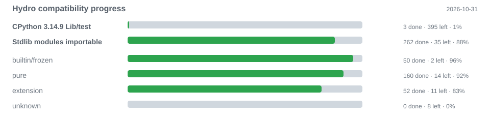

# Hydro

Hydro is the standalone Python runtime and compiler monorepo in Rust. It owns
the frontend, typed IR, Cranelift JIT/AOT backend, runtime, GC, native modules
and interpreter. The user-facing toolchain is **Tea**, maintained in its own
repository ([`haasele/tea`](https://github.com/haasele/tea)); Tea supplies
`tea run` (uv compatibility), `tea infuse` (Hydro JIT), `tea steep` (PGO
profiling flavors) and `tea brew`/`tea build` (AOT).

> **Status: early development (0.1.0).** Compiler/runtime, containers, classes,
> closures, formatting, file I/O, user modules, the stdlib core, lazy/async
> generators, task groups, precise GC roots, threads/processes, TLS/UDP
> networking, argparse/pytest, and an IR interpreter/REPL are working. A
> complete CPython stdlib and C extensions are still missing; Hydro is neither
> fully Python-compatible nor production-ready.

## Status

| Area | State |
|---|---|
| Phase 1 — Compiler, runtime ABI, JIT/AOT | done, verified by `scripts/verify.sh` |
| Phase 2 — Runtime, GC, modules, classes, concurrency | **done & verified**; precise shadow-stack GC, size-classed allocator, async generators/TaskGroup, TLS/UDP networking, pytest, interpreter/REPL |
| Phase 3 — Toolchain (`new`/`init`/`test`/`fmt`/`lint`/`clean`, build cache, uv passthrough) | moved to the separate **Tea** repository |
| Phase 4 — Python compatibility, C API/ABI | **decision B; native C-API layer imports real wheels** (0 missing link-time symbols for pinned NumPy/pandas/pydantic extensions, no `libpython`; pydantic import/model smoke and six green); full ABI semantics/stdlib/ecosystem remain open (P4-04c…P4-11), see [`docs/C_API.md`](docs/C_API.md) |
| Phase 5 — Performance | baseline + local regression gate + CPython/Hydro/PyPy/Go engine comparison |
| Phase 6 — Diagnostics/Developer Experience | largely done; CLI/diagnostic references, `--verbose`/`--quiet`, ICE and span tests; troubleshooting/migration open |

## Progress



The chart is generated from the differential reports by
`python3 scripts/progress.py`. The CPython row counts suites that pass under
both CPython 3.14.9 and Hydro; the stdlib rows count modules that import, split
by implementation layer. Exact case lists live in
[`docs/CPYTHON_TESTS.md`](docs/CPYTHON_TESTS.md) and
[`docs/COMPATIBILITY.md`](docs/COMPATIBILITY.md).

Current state of work (Cargo version 0.1.0, no public release yet): the runtime
monorepo carries the unit/integration suites; CLI/E2E/AOT tests live in Tea.
Compatibility target: **CPython 3.14.9**; the official `Lib/test` baseline is
**3/398** (`test_errno.py`, `test_int_literal.py`, `test_longexp.py`), tracked in
[`docs/CPYTHON_TESTS.md`](docs/CPYTHON_TESTS.md). The generated stdlib import
matrix is **288/297** ([`docs/COMPATIBILITY.md`](docs/COMPATIBILITY.md)).
Hydro JIT (`tea infuse`) and AOT (`tea build`) share this runtime and IR.
Details: [`docs/ARCHITECTURE.md`](docs/ARCHITECTURE.md), work list in
[`docs/TODO.md`](docs/TODO.md), source tree in
[`docs/LAYOUT.md`](docs/LAYOUT.md).

## Performance

Medians over 9 runs, a fresh process per run, AOT excluding build time. Measured on Linux x86_64 (Intel Core Ultra 7 255H, 16 cores, 24 GB) with CPython **3.14.9** as the benchmark runner and compatibility oracle, pinned to one performance core (`taskset -c 0`). Every subprocess is capped at 10 seconds.

```bash
uv run benchmarks/bench_all.py --only hydro
```

| Workload | CPython | Hydro JIT | Hydro AOT | CPython/JIT | CPython/AOT |
|---|---:|---:|---:|---:|---:|
| hello | 7.36 ms | 1.54 ms | 1.35 ms | 4.78× | 5.45× |
| while_sum | 18.89 ms | 4.28 ms | 1.83 ms | 4.41× | 10.31× |
| for_range_sum | 14.91 ms | 2.55 ms | 1.33 ms | 5.84× | 11.21× |
| list_append | 14.82 ms | 8.34 ms | 4.58 ms | 1.78× | 3.23× |
| list_comp | 12.00 ms | 5.29 ms | 3.19 ms | 2.27× | 3.76× |
| dict_insert | 8.03 ms | 2.39 ms | 2.36 ms | 3.35× | 3.40× |
| string_concat | 8.12 ms | 2.32 ms | 1.31 ms | 3.51× | 6.20× |
| json_roundtrip | 12.76 ms | 3.16 ms | 2.06 ms | 4.04× | 6.19× |
| math_loop | 22.81 ms | 3.28 ms | 1.58 ms | 6.96× | 14.48× |
| generator_sum | 9.46 ms | 5.08 ms | 4.71 ms | 1.86× | 2.01× |
| async_gather | 59.08 ms | 24.08 ms | 22.37 ms | 2.45× | 2.64× |

Measured 2026-10-29 with `repeat=5`, fresh processes, AOT excluding build time.
Hydro is faster on all 11 workloads (JIT median **3.51×**, AOT **5.45×**).
Generator resume is the narrowest compute-bound result but is now
**1.86×/2.01×** faster after removing eager frame records, per-yield registry
lookups and root-vector transfers. Startup is lower (`tea JIT hello` 1.54 ms,
`tea AOT hello` 1.35 ms, CPython 6.66 ms). P5 now focuses on PGO/inlining.

### HTTP service benchmark

The separate six-app HTTP benchmark (Node, Bun, Go, Python/FastAPI, Hydro AOT
and Hydro JIT) runs the same device API against PostgreSQL and Memcached on
one host with Docker. Fixed-load columns use one k6 generator at 10,000 GET/s
and 1,000 POST/s. Certified GET uses eight independent k6 shards and a server
connection budget of 2,048; Hydro runs eight epoll shards
(`HYDRO_HTTP_LOOPS=8`). Percentiles for the sharded run are conservative
maxima across shards.

| App | GET p50 / p99 @10k | POST p50 / p99 @1k | Certified GET req/s | Certified GET p99 | Certified CPU |
|---|---:|---:|---:|---:|---:|
| Node 26 | 0.23 / 1.06 ms | 3.01 / 6.04 ms | 63,840 | 46.92 ms | 3.13 cores |
| Bun 1.4 | 0.16 / 0.89 ms | 2.79 / 7.78 ms | 72,792 | 35.81 ms | 1.98 cores |
| Go 1.27 | 0.08 / 0.65 ms | 2.30 / 5.41 ms | 72,895 | 48.05 ms | 2.09 cores |
| Python 3.14/FastAPI | 0.55 / 1.27 ms | 3.38 / 6.50 ms | 39,883 | 224.38 ms | 6.88 cores |
| **Hydro AOT** | **0.11 / 0.83 ms** | **2.95 / 5.49 ms** | **84,812** | **21.12 ms** | **0.75 cores** |
| **Hydro JIT** | **0.11 / 0.85 ms** | **2.91 / 5.47 ms** | **84,628** | **28.83 ms** | **0.78 cores** |

Measured 2026-10-29 on the same Linux x86_64 host; fixed-load and certified
GET runs are separate. Hydro's static GET path is native epoll and never
enters Python; POST uses native `postgres.insert_device` and
`memcached.set`. The microbenchmark table above remains the compute-bound
comparison.

## Requirements

- Linux, primarily x86_64 (aarch64 paths exist but are not
  CI-verified); macOS/Windows are not yet supported.
- Rust **1.85+** (edition 2021).
- A C compiler (`cc`): the runtime build script compiles the C-variadic
  `PyArg_ParseTuple` bridge; Tea also uses `cc` to link AOT binaries.
- **Tea** (separate repository) is the CLI/toolchain; the local development
  layout expects `../tea`.
- Python 3 is used only by the benchmark harnesses and compatibility scripts
  under `benchmarks/` and `scripts/`.

## Quickstart

```bash
# 1. Build the Hydro runtime staticlib and workspace
cargo build --release -p hydro-runtime

# 2. Build Tea from the sibling repository
cargo build --release --manifest-path ../tea/Cargo.toml

# 3. Compatibility mode (CPython via uv)
../tea/target/release/tea run main.py

# 4. Hydro engine (Hydro JIT)
../tea/target/release/tea infuse main.py

# 5. AOT
../tea/target/release/tea build main.py -o hello-bin
./hello-bin

# 6. Hydro gate (fmt, clippy, runtime tests, fuzz smoke, CPython manifest)
./scripts/verify.sh
```

Tea's own gate (`../tea/scripts/verify.sh`) runs the CLI, E2E, AOT,
pytest, interpreter/REPL and flavor/PGO tests. The examples and expected
outputs stay in `examples/`.

## CLI / toolchain

The command-line tool is **Tea** and lives in its own repository. Hydro only
exposes the compiler/runtime APIs and the `libhydro_runtime.a` ABI archive.

```
tea run <file>     compatibility mode: CPython via uv
tea infuse <file>  run with the Hydro JIT (or `--interpret`)
tea steep <file>   profile a run into a named PGO flavor
tea brew|build     AOT compile/link, optionally `--flavor NAME`
tea new/init/check/test/fmt/lint/clean/gc/doctor/completions/help
```

See the Tea repository for the complete command reference, flavor storage
(`.tea/flavors/<name>.json`), merge semantics and AOT profile use.

## Language and Stdlib Scope

**Values and operators**

- `int` (arbitrary precision: tagged i64 fast path with automatic `BigInt`
  promotion; native i64 boundaries such as `range` bounds remain documented), `float`, `bool`,
  `None`, `str` (UTF-8, Unicode scalar values), `bytes`; `list`, `tuple`,
  `dict` (insertion order, O(1) lookup via hash index), `set`, `range`,
  iterators, generator/coroutine objects, function/class values.
  `iter(x)` and `next(it[, default])` are builtins.
- Arithmetic incl. `//`/`%`/`**`, comparisons, `and`/`or` (short-circuit),
  `if`/`elif`/`else`, `while`, `for`, `break`, `continue`, slices, indexing
  incl. negative indices, `in`/`not in`.

**Functions, classes, closures**

- `def`, parameters, default return, recursion; functions and lambdas are
  values, builtins likewise (`f = int`); `map`/`filter` materialize lists.
- **Closures:** mutable captured bindings use shared heap cells and support
  `nonlocal`; read-only captures keep by-value semantics. Lambdas close over
  enclosing bindings exactly like nested functions. Recursive nested
  functions are a diagnostic.
- **Classes:** `class Name(Base)` with a single base, methods, `__init__`,
  `self` attributes (`hydro_getattr`/`hydro_setattr`), inheritance/overrides,
  class attributes (`x = value`), `@property`/`@classmethod`/
  `@staticmethod` and ignored `lru_cache`/`cache`/`wraps`/`abstractmethod`/
  `overload`/`runtime_checkable` decorators.
  Metaclasses, `__prepare__`, `__set_name__` and multiple bases are supported;
  see `docs/ARCHITECTURE.md` for current descriptor/metaclass limits.
- **Integers:** arbitrary-precision `int` with a tagged i64 fast path and
  automatic `BigInt` promotion; exact arithmetic, comparisons, formatting
  and JSON beyond 64 bits.
- Comprehensions: lists/sets/dicts (eager containers) and **lazy** generator
  expressions, multiple `for` clauses, `if` filters.

**Formatting and attributes**

- f-strings with format specs (`:.2f`, `:04d`, `:#x`, alignment/fill characters)
  as well as `!s`/`!r`/`!a`; `str.format(...)`; printf formatting `"%s:%d" % (...)`;
  central spec implementation via `hydro_format_value`.
- Data attributes instead of methods on native objects: `path.name`,
  `file.closed`, `thread.name`, `process.pid` etc.; method keywords like
  `Path.mkdir(parents=True, exist_ok=True)`.

**Control flow, exceptions, context**

- `raise` (incl. `raise ... from ...`), `try`/`except [as]`/`else`/`finally`,
  re-raise, `except Exception`/`BaseException`, tuple handlers and Python-style
  tracebacks with explicit and implicit (`__context__`/`During handling ...`)
  chaining; unhandled exceptions exit with exit code 1.
- `with a as x, b as y:` via the `__enter__`/`__exit__` protocol (files,
  `Pool`, user classes); return values of `__exit__` do not suppress
  exceptions. `with` items are exited in reverse order.
- Augmented subscript assignment (`a[i] += x`) evaluates object and index
  exactly once.

**Generators and async**

- **Lazy generators:** a function containing `yield` creates a
  generator object when called; the body only runs on the first `next()`/`for`.
  `yield value`, bare `yield`, `return` as the end and exception propagation
  work; `for`/`list`/`sum`/`iter`/`next` operate on them. Each
  object is independent (stackful fiber, its own 128 KiB stack). On x86_64
  the context switch is a register-only `global_asm!` switch over the
  callee-saved registers without syscalls (`ucontext` only as a fallback for other
  targets).
- **Coroutines/event loop:** `async def` creates a coroutine object;
  `await` drives it. `asyncio.run` runs a cooperative single-thread loop,
  `asyncio.sleep` suspends only the current fiber (blocking outside a loop),
  `asyncio.gather` starts concurrent tasks, returns the
  results in input order and propagates the first error.
  Generators support `send`/`throw`/`close`, `yield` expressions and
  `yield from` (`throw` accepts exception instances only).
  Async generators, async comprehensions, `async for`/`async with`, task
  cancellation and `TaskGroup` are implemented; `ExceptionGroup`/`wait_for`
  and the wider `asyncio` API remain open. Generator expressions are lazy
  (synthetic generator function; the outermost iterable is evaluated at
  creation, the remaining clauses run per resume).

**Modules and imports**

- Native modules (see below) and **user modules**: `import foo` /
  `from foo import f` resolve a sibling file, a package (`foo/__init__.py`),
  dotted and relative submodules, `HYDRO_SITE_PACKAGES`, venv/conda
  site-packages, `PYTHONPATH`, `HYDRO_STDLIB` (a CPython `Lib` tree) and
  finally the pure-Python modules vendored in the repository's `stdlib/`
  directory, so explicit roots always win over the vendored tree. Each unit
  loads once per canonical path, imported module bodies run once as
  initializers, and import cycles are diagnosed. `from x import *` and a
  general `sys.modules`/`sys.path` model are missing.
- Standard-library modules are first-class values (`m = errno`,
  `getattr(errno, name)`) and expose their constants through `hydro_module_get`.
  Module-level assignments are visible inside functions and methods.
- `__name__` is `"__main__"` in the entry file. There is no general runtime
  module object or `sys.modules`; user-module values are still rejected.

**Bundled modules** (native, without CPython):

`math`, `functools`, `operator`, `time`, `sys`, `json` (`dumps`/`loads`,
`dump`/`load`), `os` (basic, `remove`/`rename`, `fork`/`waitpid`/`_exit`),
`os.path` (`join`, `basename`, `dirname`, `exists`, `isfile`, `isdir`,
`abspath`, `splitext`, `split`), `io`/`open` (text and bytes), `csv`,
`argparse` (subset, `Namespace`), `collections.defaultdict`, `re`
(Rust `regex`: `search`/`match`/`fullmatch`/`findall`/`sub`/`split`,
`Pattern`/`Match`), `socket` (blocking TCP), `random`, `platform`,
`statistics`, `pathlib`, `_thread`, `threading`, `queue`, `multiprocessing`,
`pickle`, `asyncio` (only `run`/`sleep`/`gather`), `errno` (full Linux
constant table, `errorcode`, module `__dict__`), `typing`, `abc`,
`types`, `itertools`, `ast`, `fractions`, `importlib`, `__future__`,
`dataclasses`, `datetime`, `contextlib`, `html`, a minimal `unittest`
(`TestCase` + runner via `main`, native assertions), and Batch A of the
standard-library program (`bisect`, `heapq`, `colorsys`, `keyword`, `stat`,
plus the `_bisect`/`_heapq`/`_stat`/`_operator`/`_functools`/`_io` aliases
and `binascii`, `base64`, `quopri`, `fnmatch`, `getopt`, `mimetypes`,
plus the benchmark-critical `subprocess`, `tempfile`, `shutil`, `textwrap`,
`timeit`).

`enum` is not native: CPython 3.14.9's `Lib/enum.py` is vendored with documented
Hydro adaptations in `stdlib/enum.py` (PSF license notice in `stdlib/LICENSE`), so `Enum`,
`IntEnum`, `IntFlag`, `Flag`, `StrEnum` and `auto()` follow CPython semantics.

**Concurrency and memory**

- No GIL; threads share a heap with a concurrent mark-&-sweep GC
  (short stop-the-world windows for root snapshot/rescan).
- `threading` (`Thread`, `Lock`, `RLock`, `Event`, `queue.Queue`),
  `multiprocessing` (`Process`, `Queue`, `Pool`, fork and spawn, context
  manager for `Pool`), `pickle` with its own, **not CPython-compatible**
  HYD1 format.
- Shared containers must be protected by user locks;
  unprotected mutations are data races.

**Not supported (selection)**

User decorators and pattern matching remain incomplete; `except*` grouping and
`await`/cancellation edge cases are still open. The general descriptor and
metaclass protocols, `bytearray`/`memoryview`, async generators and async
comprehensions are implemented. Arbitrary C extensions/full CPython ABI
semantics and the complete stdlib remain open (288/297 modules import; see
[`docs/COMPATIBILITY.md`](docs/COMPATIBILITY.md)). A general `sys.path`/
`sys.modules` model, dynamic imports from unlinked packages, namespace/zip/
frozen imports and `from x import *` are incomplete; packages, dotted/relative
imports, `site-packages` and vendored `stdlib/` resolution work. Package
management is a uv passthrough (no interpreter injection/packaging).

## Architecture

```
Source .py (+ imported sibling modules, packages, site-packages) → rustpython-parser → hydro-frontend
                                                          ↓
                                          typed IR (hydro-ir)
                                                          ↓
                     hydro-codegen (Cranelift) → JIT (tea infuse)
                                             → object + cc link (tea build)
                                                          ↓
                                hydro-runtime (libhydro_runtime.a, C ABI)
```

| Crate | Responsibility |
|---|---|
| `crates/hydro-ir` | typed HIR, contract between frontend and codegen, stdlib specs |
| `crates/hydro-frontend` | parsing, module loader/user modules, lowering, type inference, diagnostics |
| `crates/hydro-runtime` | value model, operators, builtins, exceptions, GC, I/O, modules, concurrency |
| `crates/hydro-codegen` | Cranelift codegen for the JIT and AOT path |

Internally the crates are structured into `model`/`ir`/`stdlib`, `lower`/`sema`,
`backend`/`lower`, `core`/`gc`/`modules`/`concurrency`/`support` and
`session`; the complete tree is in
[`docs/LAYOUT.md`](docs/LAYOUT.md). The ABI and IR contracts are authoritatively
documented in [`docs/ARCHITECTURE.md`](docs/ARCHITECTURE.md).

## Tests and Benchmarks

- `./scripts/verify.sh`: `cargo fmt --check`, Clippy (`-D warnings`), runtime
  build, **`cargo nextest run --workspace` on all cores**, fuzz smoke and the
  offline CPython manifest check. The 2026-10-30 run lists 2905 tests
  (2905 passed, 1 skipped). CLI/E2E/AOT gates live in the Tea repository.
- CI: [`.github/workflows/ci.yml`](.github/workflows/ci.yml) (Ubuntu, stable
  Rust, fmt/clippy/nextest/verify, no secrets).
- Benchmarks: [`benchmarks/HYDRO.md`](benchmarks/HYDRO.md) describes readiness and
  integration of the CPython harnesses; `benchmarks/hydro/run_micro.py` measures
  CPython vs. Hydro JIT vs. Hydro AOT (incl. thread/process/pool scaling) and
  writes `benchmarks/hydro/results/latest.json`. `benchmarks/bench_hydro.py`
  compares 11 pure Python workloads (incl. lazy generator and async
  `gather`) under CPython/JIT/AOT and is registered as `hydro` in `bench_all.py`;
  the 10-second per-run configuration is documented in the Performance
  section. Generic aliased string concatenation remains O(n²), and generator
  suspension is the narrowest compute-bound result.
- Regression thresholds: `benchmarks/hydro/thresholds.json` check the JIT/AOT
  medians of the core workloads:

  ```bash
  python3 benchmarks/hydro/run_micro.py
  python3 scripts/check_benchmarks.py            # --check, exit 1 when exceeded
  python3 scripts/check_benchmarks.py --update   # rewrite baseline
  ```

  The gate compares only workloads that are present in both the result and
  threshold file. Enforcement stays local/release-only: timing on shared
  runners is too noisy for a blocking CI gate. CI runs the check as a
  non-blocking report and runs `scripts/test_check_benchmarks.py`. Thresholds
  were tightened after the 2026-10-29 hot-path work; the current suite passes
  45/45 checks with the generator workload faster than CPython.
- Harnesses: `scripts/bench_hyperfine.sh` wraps the `bench_*.py` scripts in
  hyperfine with output validation (skips cleanly when hyperfine/uv is
  missing); `benchmarks/compare_engines.py` compares loop/startup under
  CPython, Hydro, PyPy and Go and reports missing engines as skipped.
- Releases: Hydro publishes the runtime staticlib/source archive; Tea owns the
  Linux x64 CLI/AOT binary packaging, checksums, smoke tests and reproducible
  artifact checks in its own repository.

## Contributing

Setup, gate and commit rules: [`CONTRIBUTING.md`](CONTRIBUTING.md). Before
larger changes, a look at [`AGENTS.md`](AGENTS.md) and
[`docs/TODO.md`](docs/TODO.md) is worthwhile (the current state of work is documented there).

## License

Licensed under **MIT OR Apache-2.0** (see `Cargo.toml`). The
full texts are in [`LICENSE-MIT`](LICENSE-MIT) and
[`LICENSE-APACHE`](LICENSE-APACHE); you may choose the terms of either
license.
